# TP3 — Réponses

**Binôme :** Hadil Ezzine — Meryem khlifi


## Partie 1 — Pyramide des tests

**Q1.**

| Dossier | Niveau | Outil | Stack Docker nécessaire ? |

| `tests/unit` | Unitaire (base) | Vitest | Non |
| `tests/component` | Composant | Vitest + Testing Library (jsdom) | Non |
| `tests/integration` | Intégration | Vitest | Oui : Strapi et postgres |
| `tests/e2e` | Bout en bout (sommet) | Playwright (Chromium) | Oui : toute la stack |

**Q2.** La base est large parce qu'il y a beaucoup de tests unitaires : ils sont rapides, simples à écrire, stables, et quand l'un échoue on sait tout de suite quelle fonction est en cause. Le sommet est étroit parce que les tests E2E sont lents (un vrai navigateur), plus fragiles, demandent toute la stack, et quand ils échouent on ne voit pas directement où est le problème. On en écrit donc peu, seulement pour les parcours importants.

## Partie 2 — Tests unitaires

**Q3.** J'ai 17 tests (9 unitaires, 4 de composant pour `CoursCard` et 4 pour `CoursFilters`). 1 échoue et 16 passent. Le test qui échoue vérifie `formatDuration` pour une heure pleine : il attend `"1 h"` mais la fonction renvoie `"1 h 0"`. `Expected` est la valeur attendue par le test, `Received` est la valeur réellement renvoyée par la fonction.

**Q4.** Pour 60 minutes, `rest` (les minutes qui restent) vaut 0. L'ancienne dernière ligne, `` return `${hours} h ${rest}` ``, affichait quand même ce 0 : `"1 h 0"`. La correction `` rest === 0 ? `${hours} h` : `${hours} h ${rest}` `` ajoute les minutes seulement s'il y en a. Donc 60 minutes donne `"1 h"` et 90 minutes donne toujours `"1 h 30"`.

**Q5.** Avant d'ajouter des tests, pour `lib/cours.ts` : lignes 93,33 % (14/15), branches 78,57 % (11/14), fonctions 85,71 % (6/7), instructions 88,23 % (15/17). Dans le rapport HTML, la ligne 48 est en rouge : `return normalize(c.title).includes(needle) || c.topics.some(...)`. Aucun test ne cherchait avec un texte non vide (seul le cas `needle === ""` était exécuté), donc cette ligne et ses branches n'étaient jamais exécutées.

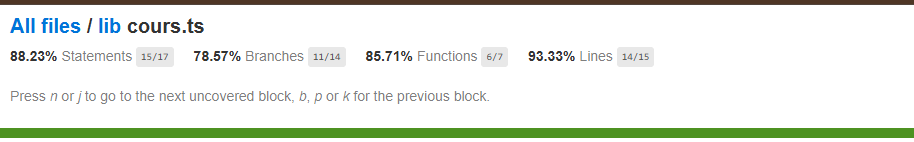

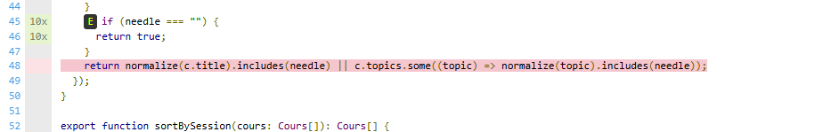

**Q6.** Après les 2 tests ajoutés : lignes 100 % (15/15), branches 100 % (14/14), fonctions 85,71 % (6/7), instructions 94,11 % (16/17). Les tests exécutent maintenant la ligne 48 : le test « recherche + niveau » (`git` + débutant) passe par la vraie recherche, et le test de la liste vide vérifie le cas limite. Il reste quand même quelque chose de non couvert : dans le rapport, la partie après le `||`, c'est-à-dire `c.topics.some((topic) => normalize(topic).includes(needle))`, est surlignée en rouge. Cela fait 1 fonction sur 7 (la fonction fléchée) et 1 instruction sur 17. La raison : dans mes tests, le mot cherché est toujours trouvé dans le titre, donc JavaScript n'évalue jamais la deuxième partie du `||`. Il faudrait un test avec un mot qui n'existe que dans les sujets (`topics`).

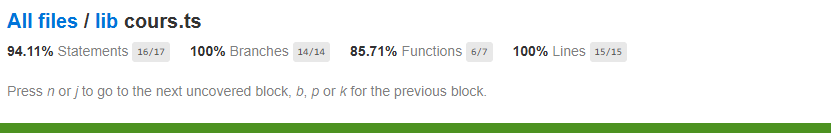

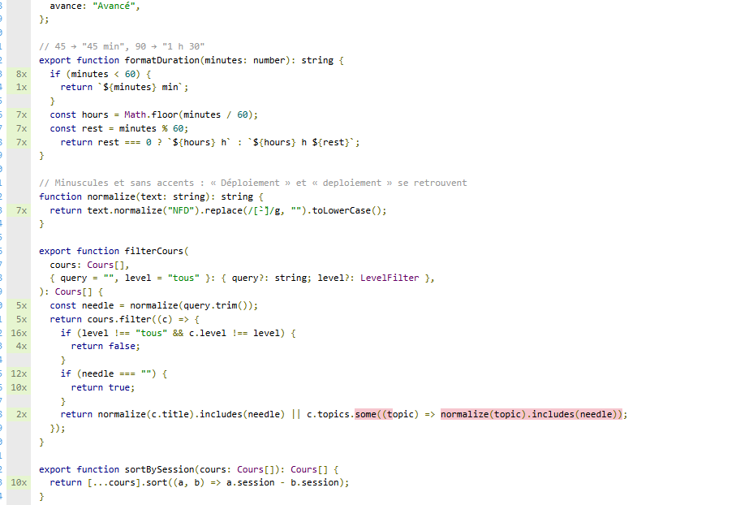

**Q7.** La couverture de lignes compte les lignes exécutées au moins une fois. La couverture de branches compte les chemins possibles d'un `if`, d'un `||` ou d'un `? :` : une ligne peut être exécutée sans que tous ses chemins le soient (avant mes tests : 93 % de lignes mais 78 % de branches). Un code couvert à 100 % n'est pas forcément sans bug, car la couverture montre que le code a tourné, pas que le résultat a été vérifié. Exemples du TP : après mes tests, la ligne 48 compte comme couverte alors que la moitié de la ligne (`topics.some`) n'est jamais exécutée. Et le bug `"1 h 0"` était dans une fonction dont les lignes étaient exécutées : c'est un test qui vérifie la valeur exacte qui l'a trouvé.

## Partie 3 — Tests de composant

**Q8.** `CoursCard.test.tsx` vérifie que le composant affiche le titre sous forme de lien vers la fiche du cours, donc ce que voit l'utilisateur dans la page. Un test unitaire de `formatDuration` vérifie seulement le texte renvoyé par une fonction. Le navigateur est simulé par **jsdom**, configuré dans `vitest.config.mts` (option `environment`).

**Q9.** On cherche par rôle ou par texte parce que c'est comme ça qu'un utilisateur trouve un élément (un lien, un bouton, un titre). Le test reste valide si on change le CSS ou la structure du HTML, et il vérifie aussi l'accessibilité. Une classe CSS est un détail technique qui change souvent.

**Q10.** `app/page.tsx` est une page Next.js qui s'exécute côté serveur et appelle Strapi à chaque requête, ce qui se simule mal dans jsdom. Elle est couverte par les tests E2E, qui ouvrent le vrai site (liste des 6 cours, recherche, filtre, fiche d'un cours).

## Partie 4 — Tests d'intégration

**Q11.** Ils vérifient que le code de `lib/api.ts` communique bien avec le vrai Strapi : la bonne URL, les permissions du rôle Public, la forme du JSON reçu et sa transformation en objets `Cours`. Les tests unitaires et de composant n'utilisent pas Strapi, donc ne voient pas ces problèmes.

Avec Strapi qui tourne, mes 4 tests passent (6 cours du seed, tri par séance, fiche d'un cours, `null` pour un identifiant inexistant).

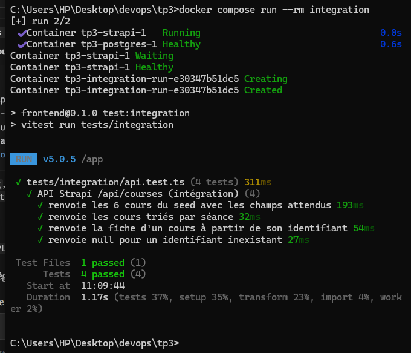

**Q12.** Avec Strapi arrêté, les 4 tests d'intégration échouent avec `TypeError: fetch failed`, causé par `getaddrinfo ENOTFOUND strapi` : le nom `strapi` ne se résout plus, car le conteneur est arrêté. Les tests sont aussi beaucoup plus lents (environ 18 s au lieu de 1 s) à cause des délais d'attente. Les tests unitaires passent toujours, parce qu'ils testent des fonctions seules, sans réseau, donc sans Strapi. `--no-deps` empêche `docker compose run` de redémarrer les services de `depends_on` : sans lui, Strapi serait relancé avant les tests et on ne verrait pas l'échec.

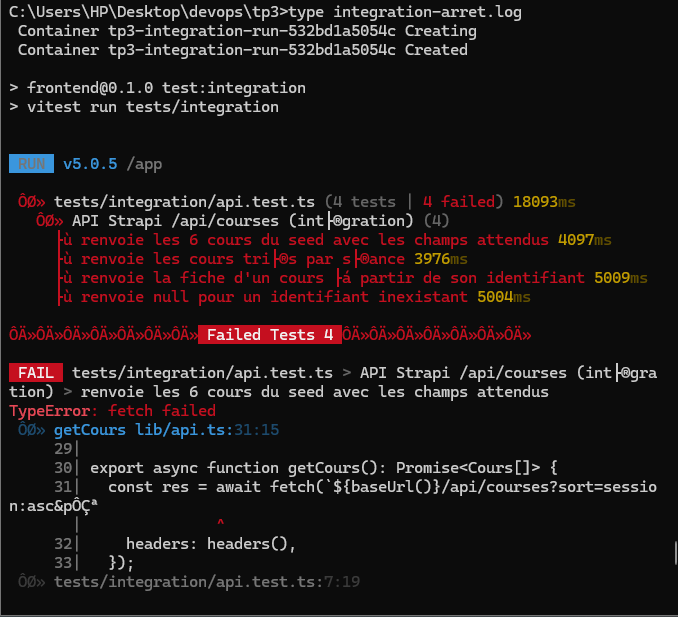

**Q13.** Non, un test d'intégration qui échoue n'est pas forcément un bug du code. Autres causes possibles : Strapi pas démarré ou pas encore `healthy` (comme ici), les données de départ absentes (les 6 cours non créés), les permissions du rôle Public non accordées, un problème de réseau Docker, ou un délai d'attente (timeout) trop court.

## Partie 5 — Tests de bout en bout

**Q14.** Le scénario qui échoue est « la fiche du cours d'introduction affiche sa durée » (`parcours.spec.ts:27`). Les 3 autres passent. Le rapport montre que l'attente `toBeVisible` du texte `1 h` a duré 5 secondes sans succès. La capture d'écran et la trace montrent la fiche « Introduction au DevOps » avec la durée **« 1 h 0 »** au lieu de `1 h`. C'est le bug de la question Q3 (`formatDuration`). Il échoue alors que j'ai corrigé le code en partie 2, parce que le conteneur `frontend` avait été construit **avant** la correction : l'image Docker garde l'ancien code tant qu'on ne la reconstruit pas avec `docker compose up -d --build frontend`. Après la reconstruction, les 4 tests passent.

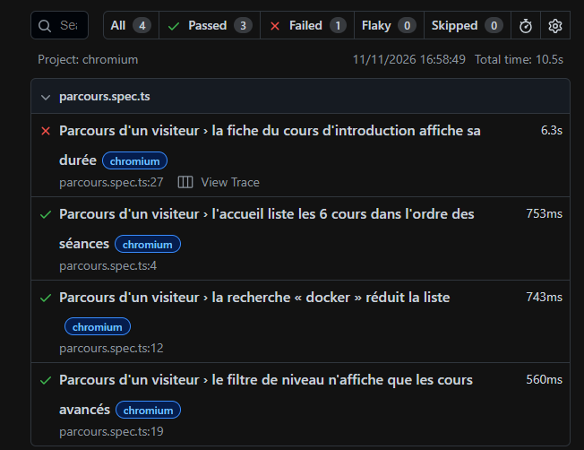

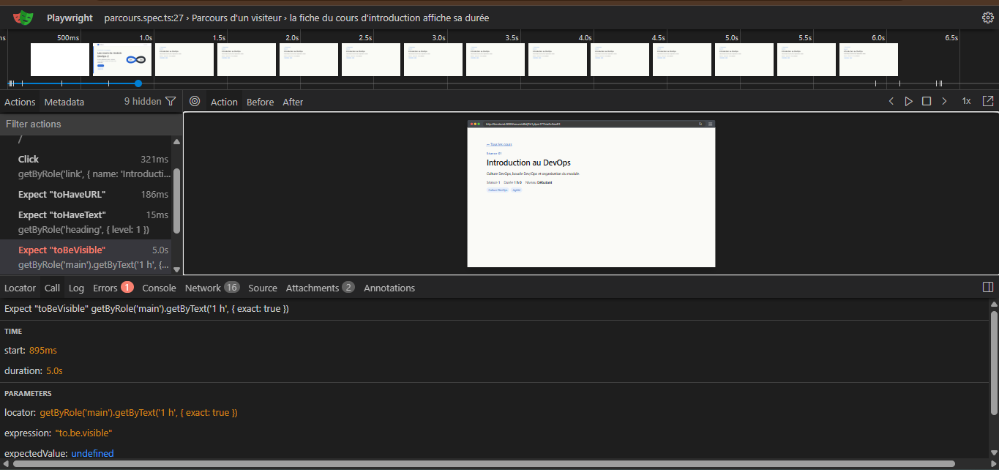

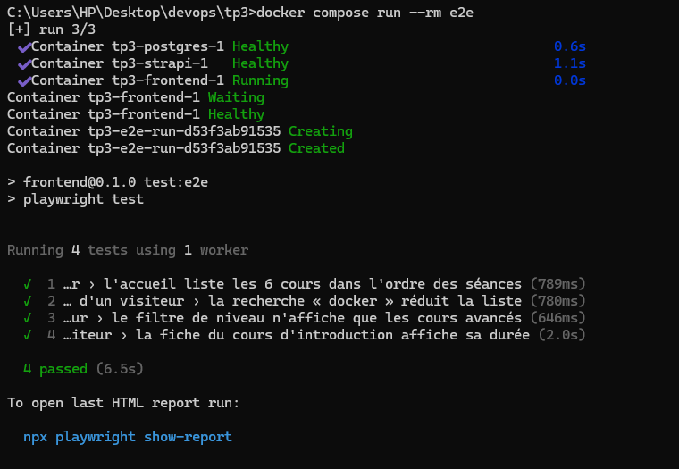

**Q15.** Le test unitaire permet de trouver la cause le plus vite : il pointe directement la fonction `formatDuration` avec la valeur attendue et la valeur obtenue. Le test E2E prouve que l'utilisateur est touché : on voit sur la vraie page du site que la durée affichée est fausse.

**Q16.**

| Niveau | Nombre de tests | Durée d'exécution | Besoin de la stack ? |
|---|---|---|---|
| Unitaire + composant | 19 | 4,20 s | Non |
| Intégration | 4 | 1,17 s | Oui (Strapi et postgres) |
| E2E | 4 | 6,5 s | Oui (toute la stack) |

**Q17.** Un test flaky (instable) réussit parfois et échoue parfois sans que le code ait changé, par exemple à cause du temps de chargement. Playwright réduit ce risque : il attend automatiquement que l'élément soit prêt avant d'agir, et ses assertions comme `expect(...).toBeVisible()` ou `toHaveCount` réessayent pendant un délai (5 s dans mon rapport) au lieu de vérifier une seule fois. Chaque test part aussi d'un navigateur propre.

## Partie 6 — SonarQube

**Q18.** Mon `sonar-project.properties` :

```properties
sonar.projectKey=tp3-cours
sonar.projectName=TP3 - Cours DevOps

sonar.sources=app,components,lib
sonar.tests=tests
sonar.javascript.lcov.reportPaths=coverage/lcov.info

sonar.exclusions=node_modules/**,.next/**,coverage/**,playwright-report/**,test-results/**
sonar.coverage.exclusions=app/**,lib/api.ts,components/CoursList.tsx,components/DevOpsLoop.tsx,*.config.*

sonar.sourceEncoding=UTF-8
sonar.qualitygate.wait=true
```

- `sonar.projectKey` : l'identifiant du projet dans SonarQube (`projectName` est son nom affiché).
- `sonar.sources` : les dossiers du code à analyser (`app`, `components`, `lib`).
- `sonar.tests` : le dossier des tests, pour qu'ils ne soient pas comptés comme du code applicatif.
- `sonar.javascript.lcov.reportPaths` : le fichier de couverture `lcov.info` produit par Vitest.
- `sonar.exclusions` : les dossiers ignorés par l'analyse (dépendances, build, rapports).
- `sonar.coverage.exclusions` : les fichiers qu'on ne compte pas dans la couverture.
- `sonar.qualitygate.wait=true` : le scanner attend le verdict du Quality Gate et échoue s'il est rouge.

On exclut `app/**` et `lib/api.ts` du calcul de couverture parce que Vitest (tests unitaires et de composant) ne les teste pas : la page serveur est couverte par les tests E2E et `api.ts` par les tests d'intégration, qui ne produisent pas ce rapport `lcov`. Sans l'exclusion, la couverture baisserait à cause de fichiers pourtant testés ailleurs.

**Q19.** Avec le Quality Gate TP3, le statut est **Failed** : 1 condition en échec, « Vulnerabilities is greater than 0 ». Les chiffres du rapport : 0 bug, 1 vulnérabilité, 0 security hotspot, 14 code smells, couverture 97,8 % (sur 27 lignes à couvrir), duplication 5,6 % (sur 856 lignes). La condition de couverture (moins de 90 %) est bien respectée.

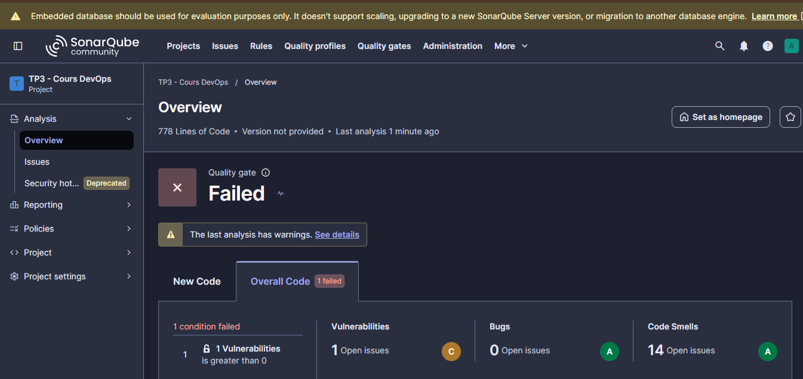

**Q20.**
- **Bug** : une erreur qui fait mal fonctionner le programme. Je n'en ai aucun (0).
- **Vulnérabilité** : une faille de sécurité qui peut être exploitée. Dans mon rapport : « Review this potentially hard-coded password » dans `lib/api.ts` (gravité Major).
- **Security hotspot** : du code sensible pour la sécurité qu'un humain doit relire, car SonarQube ne peut pas dire si c'est vraiment dangereux. Je n'en ai aucun (0).
- **Code smell** : du code qui marche mais qui est mal écrit, donc difficile à lire ou à maintenir. Exemple : « Refactor this function to reduce its Cognitive Complexity from 16 to the 15 allowed » dans `CoursList.tsx` (gravité Critical).

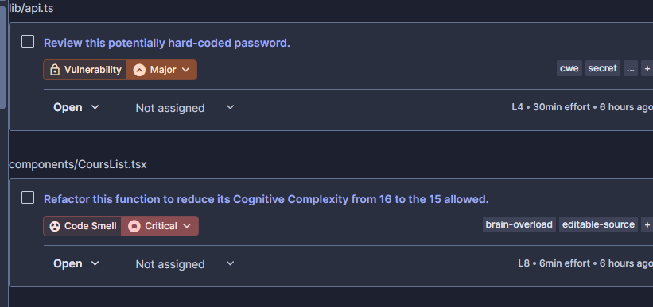

**Q21.** La règle est « mot de passe codé en dur » (étiquettes `cwe` et `secret`) : le mot de passe `"Tp3-Cours-2026!"` était écrit directement dans `lib/api.ts`. Le risque est que toute personne qui lit le code peut le voir et l'utiliser. Après la correction, le mot de passe vient de la variable d'environnement `STRAPI_CLIENT_PASSWORD`. Chemin : la valeur est écrite dans `.env` (qui n'est pas commité), `docker-compose.yml` la passe au conteneur `frontend` avec `STRAPI_CLIENT_PASSWORD: ${STRAPI_CLIENT_PASSWORD}`, et le code la lit avec `process.env.STRAPI_CLIENT_PASSWORD`. Un secret dans le code est dangereux même dans un dépôt privé : il reste dans l'historique Git, il est copié chez tous ceux qui clonent, il peut fuiter si le dépôt devient public, et pour le changer il faut modifier et redéployer le code. Après la correction, SonarQube affiche 0 vulnérabilité.

**Q22.** Avant la correction il y avait 14 code smells, après il y en a 9 : 5 ont disparu, et ils étaient dans `CoursList.tsx`, le seul fichier de code modifié pour les smells.
- **Complexité cognitive** : « Refactor this function to reduce its Cognitive Complexity from 16 to the 15 allowed », gravité **Critical** (étiquette `brain-overload`), effort de 6 min. Elle veut dire que la fonction avait trop de conditions imbriquées et était difficile à lire. Dans le nouveau code, le message est découpé en deux petites fonctions : `describeEmpty` traite les cas « aucun résultat » avec des `if` et des `return` simples, et `describeResults` fait juste un test `count === 0`. Chaque fonction est plus simple, donc la complexité passe sous 15.
- **Les 4 autres smells** venaient de la même ancienne fonction `describeResults` (conditions imbriquées écrites en une seule expression). Le nouveau code les remplace par des `if` / `return` successifs, plus faciles à lire.

Il reste un smell dans `CoursList.tsx` : « Mark the props of the component as read-only » (règle S6759, gravité Minor, 5 min), que la correction fournie ne traite pas.

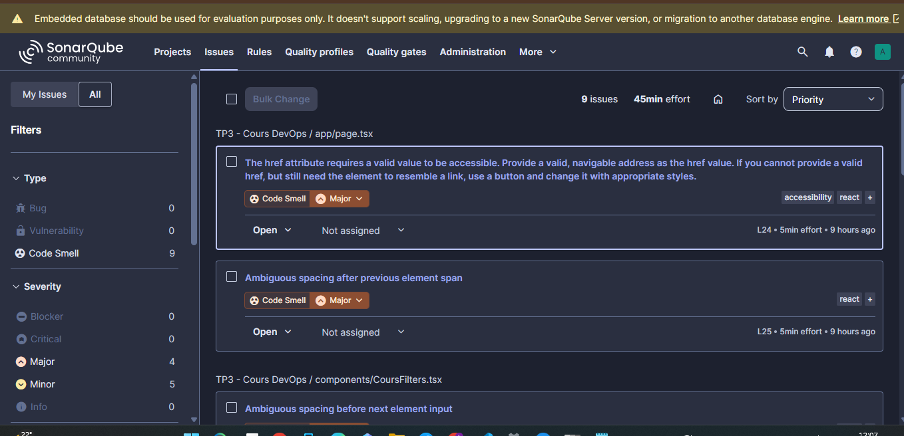

**Q23.** SonarQube indique 5,7 % de lignes dupliquées après correction (5,6 % avant, sur 856 lignes). Pour supprimer la duplication, on mettrait le code répété dans une fonction ou un composant partagé qu'on appelle aux deux endroits, au lieu de le copier.

**Q24.** La dette technique est le temps estimé pour corriger les problèmes de maintenabilité (les code smells). SonarQube l'affiche comme un « effort » en minutes ou en heures, avec une note de A à E. Avant la correction : 14 code smells (environ 5 min chacun, 6 min pour celui de complexité cognitive), note A. Après la correction : 9 code smells, soit **45 min** d'effort, toujours note A. La dette a donc baissé avec la correction.

**Q25.** Le « New Code » est le code ajouté ou modifié depuis un point de référence (par exemple la dernière version). Les conditions sur le New Code dans le gate sont celles de « Sonar way », que mon gate TP3 garde : 0 nouveau problème, tous les nouveaux security hotspots relus, couverture du nouveau code d'au moins 80 %, au plus 3 % de lignes dupliquées. SonarQube recommande de juger le nouveau code parce qu'on ne peut pas toujours corriger tout l'ancien code, mais on peut s'assurer que chaque nouvelle modification est propre : la qualité ne baisse plus, sans bloquer le projet à cause du passé.

**Q26.** Avec `sonar.qualitygate.wait=true`, le scanner attend le verdict du Quality Gate, et quand il est rouge il se termine en erreur (`QUALITY GATE STATUS: FAILED`). Dans un pipeline CI, ça fait échouer l'étape automatiquement : un code de mauvaise qualité ne peut pas être fusionné ni déployé sans que quelqu'un le remarque.

Après mes corrections, le Quality Gate est passé au vert : 0 vulnérabilité, 0 bug, 9 code smells, couverture 97,8 %, duplication 5,7 %.

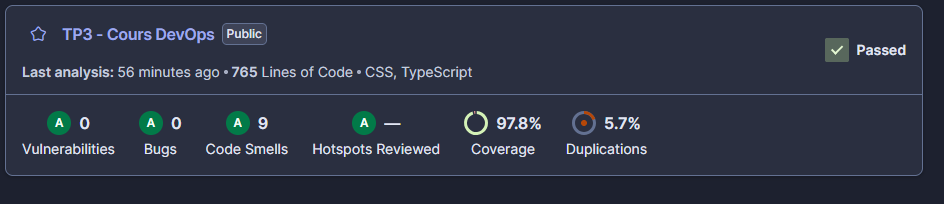

## Partie 7 — Synthèse

**Q27.** Ordre proposé pour le pipeline CI :
1. **Build** des images (si le code ne compile pas, inutile d'aller plus loin).
2. **Tests unitaires et de composant** : les plus rapides, ils donnent un retour en quelques secondes.
3. **Analyse SonarQube** : elle a besoin de la couverture produite à l'étape 2, et elle vérifie le Quality Gate.
4. **Démarrage de la stack, puis tests d'intégration** (Strapi et postgres).
5. **Tests E2E** : les plus lents, à la fin, quand tout le reste est bon.

On met les étapes rapides et peu chères en premier : on échoue vite et on ne lance pas les étapes lentes pour rien. Toutes ces étapes doivent bloquer le merge d'une pull request : le build, les tests unitaires, d'intégration et E2E, et le Quality Gate SonarQube.
